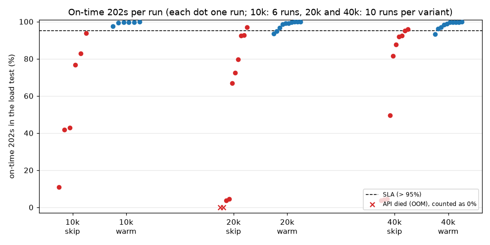
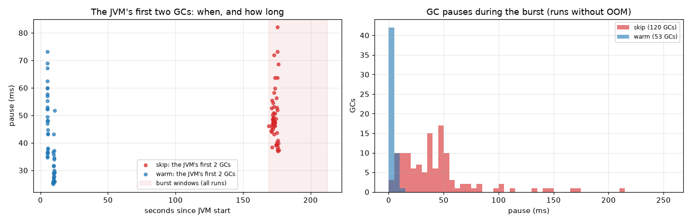
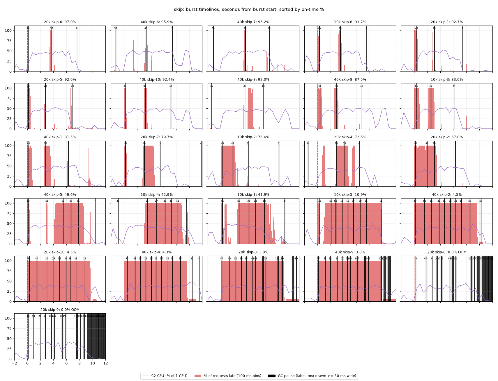
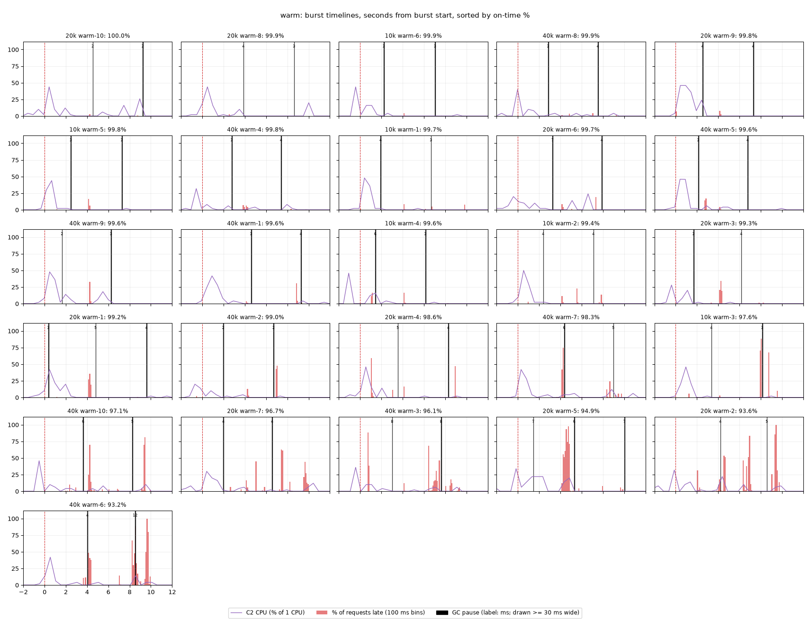
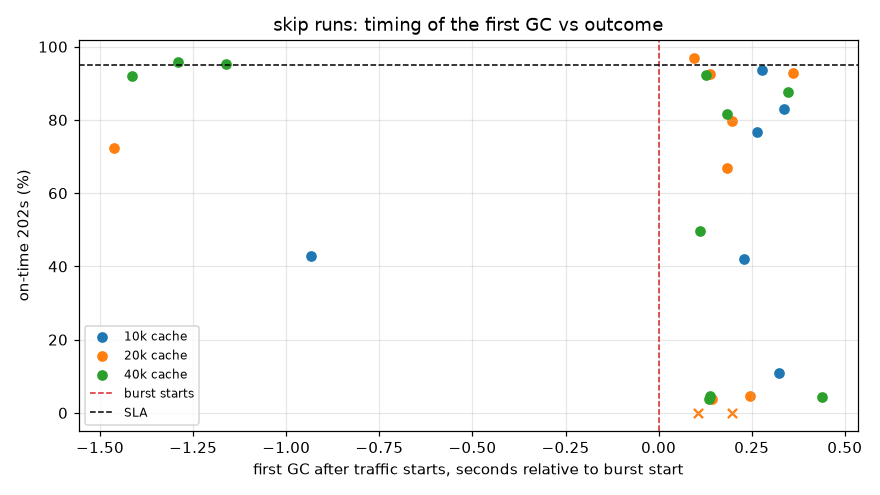
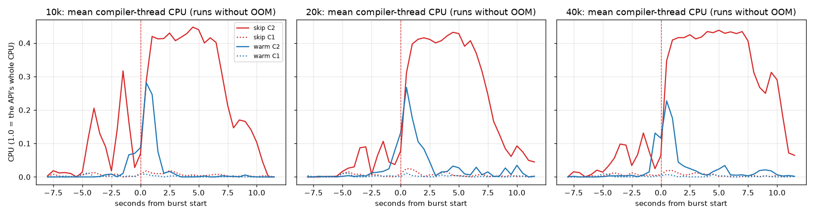

# Skip vs warm rerun, with GC events: the first two GCs land in the burst

Experiment `20261119-jit-5s`, run 2026-11-19 03:37–08:13: 52 runs. It follows up
[`../20261119-jit-delay/REPORT.md`](../20261119-jit-delay/REPORT.md), which inferred that skip collapses when
its first GC lands at the burst onset.

## Summary

- **Warm-up is reliable and skip is not.**
  - Warm passed 23 of 26 runs, with a median of 99.5% on time.
  - Skip passed 3 of 26, with a median of 74.5%. Eight skip runs collapsed to ≤ 11%, and two of those died
    with OOM.
  - The training size (10k, 20k, 40k calls) doesn't change this.
- **Skip's misses come from GC pauses that skip's own startup sets up.**
  - The skip JVM never runs a GC during its 80 s idle period or the functional checks. Its first two GCs, the
    expensive ones, therefore happen at the load test. In 21 of 26 runs both land inside the burst; in the
    other 5, the first comes 0.9–1.5 s before it.
  - Each of these two GCs pauses for 37–82 ms. Each costs hundreds to 1,400 late requests, because C2 is using
    about 0.4 of the single CPU at that time and the backlog can't drain. The SLA allows 1,050 late requests.
  - Warm runs take their first two GCs (25–73 ms) about 5 and 10 s after JVM start, during warm-up.
  - Later GCs are cheap in both variants: 2–14 ms.
- **The previous report's explanation was half right.** The GC-at-onset explanation holds, but it's the first
  two GCs, not only the first. A first GC before the burst doesn't save a run: only 2 of those 5 runs passed,
  because the second expensive GC came at +2.9 to +3.7 s and cost 294–1,400 late requests.
- **When a run never recovers:** once the backlog builds, allocation goes up, so GC runs every 0.8–1.2 s
  instead of every 3–4 s. Those runs had 9–13 GCs during the burst, against 2–3 in runs that recovered. Four of
  them then hit a deoptimization storm and two ran out of heap; both are consequences of the collapse, not
  causes.
- **Warm's 3 failures (93.2–94.9%) are not GC or JIT.** Its burst GCs pause for at most 12 ms and C2 is about
  idle. The misses come from 0.1–0.8 s stalls whose cause isn't identified.

## Setup (changes from jit-delay)

- **Same as before:**
  - the API container: 1 CPU, SerialGC, 60% of RAM as heap;
  - the AOT caches (`aot10k`, `aot20k`, `aot40k`), Postgres and the 4 workers;
  - the variants: skip is `-XX:+SkipTier2IfPossible` with idle until 80 s after container start; warm is the
    startup warm-up with traffic 10 s after healthy;
  - the checker (`scripts/check.sh`): 1 / 100 / 2,000 / 100 / 1 req/s; the burst is 2,000 req/s for 10 s; to
    pass, more than 95% of requests must get a 202 within 35 ms;
  - the DB was truncated before each run.
- **Variants:** only skip and warm; "none" was dropped because it always died with OOM.
- **Repetitions:** 6 per cache and variant, interleaved by repetition, then cache, then variant. Any group
  with both passes and failures then got 4 more runs (`tools/all.sh`). That was 20k skip, 20k warm, 40k skip
  and 40k warm, so 10k has 6 runs per variant and 20k and 40k have 10.
- **JFR** (`tools/jit.jfc`):
  - periodic events every 5 s instead of 1 s;
  - added `jdk.GarbageCollection` and `jdk.GCPhasePause` (no threshold), `jdk.SafepointBegin` (over 5 ms)
    and `jdk.Deoptimization` (without stack traces).
- **CPU sampling:** host per-thread CPU every 0.5 s (`tools/thread_cpu.py`). The CPU graphs use this, since
  JFR now samples only every 5 s.

## Results

| Cache | Variant | Runs | Passed | On-time % per run, sorted |
|---|---|---|---|---|
| 10k | skip | 6 | 0 | 93.7, 83.0, 76.6, 42.9, 41.9, 10.9 |
| 10k | warm | 6 | 6 | 99.9, 99.8, 99.7, 99.6, 99.4, 97.6 |
| 20k | skip | 10 | 1 | 97.0, 92.7, 92.6, 79.7, 72.5, 67.0, 4.5, 3.8, OOM, OOM |
| 20k | warm | 10 | 8 | 100.0, 99.9, 99.8, 99.7, 99.3, 99.2, 98.6, 96.7, 94.9, 93.6 |
| 40k | skip | 10 | 2 | 95.9, 95.2, 92.4, 92.0, 87.5, 81.5, 49.6, 4.5, 4.3, 3.8 |
| 40k | warm | 10 | 9 | 99.9, 99.8, 99.6, 99.6, 99.6, 99.0, 98.3, 97.1, 96.1, 93.2 |

Every check other than the load test passed in every run, except the two runs that died with OOM.

## Why skip fails: the first two GCs

**Left:** when the JVM's first two GCs happen, and how long each pauses.
- In warm runs they happen 5–11 s after JVM start, during warm-up, with pauses of 25–73 ms.
- In skip runs they happen at about 170–176 s, during the load test, with pauses of 37–82 ms. No skip run had
  a single GC before checker traffic started.

**Right:** GC pauses during the burst.
- Warm's are all 2–12 ms.
- Skip's include the two expensive GCs. Runs that collapse add many more GCs, some of 100–250 ms. The OOM
  runs are left out of this panel.

The likely reason the first two GCs are expensive: eden holds everything the application allocated at
startup that is still alive. The first collection copies it into a survivor space and the second promotes it.
After that, young GCs only find short-lived request garbage. This is inferred: the recording has no heap-usage
events. It does match the 2–14 ms pauses of every later GC.

### Burst timelines

Each panel shows one run, sorted by on-time %:
- **red bars:** % of requests late, in 100 ms bins of scheduled send time;
- **purple line:** C2 thread CPU;
- **black bars:** GC pauses, labeled in ms and drawn at least 30 ms wide;
- **t = 0:** burst start.

### Skip runs: the first two GCs and what each cost

Times are relative to the burst start. "Late" counts requests scheduled from 0.1 s before to 0.6 s after each
GC starts. The maximum is 1,400, every request in that 0.7 s.

| Run | On time | 1st GC: time, pause | 2nd GC: time, pause | Late around 1st / 2nd GC | GCs in burst |
|---|---|---|---|---|---|
| 20k skip-6 | 97.0% | +0.09 s, 54 ms | +3.73 s, 37 ms | 52 / 249 | 3 |
| 40k skip-6 | 95.9% | −1.29 s, 56 ms | +3.35 s, 40 ms | 0 / 410 | 2 |
| 40k skip-7 | 95.2% | −1.16 s, 53 ms | +3.74 s, 69 ms | 1 / 633 | 2 |
| 10k skip-6 | 93.7% | +0.28 s, 49 ms | +3.49 s, 73 ms | 2 / 540 | 3 |
| 20k skip-1 | 92.7% | +0.36 s, 46 ms | +3.07 s, 39 ms | 560 / 35 | 3 |
| 20k skip-5 | 92.6% | +0.14 s, 72 ms | +2.75 s, 38 ms | 967 / 128 | 3 |
| 40k skip-10 | 92.4% | +0.13 s, 47 ms | +3.20 s, 82 ms | 655 / 827 | 3 |
| 40k skip-3 | 92.0% | −1.41 s, 46 ms | +3.69 s, 37 ms | 2 / 294 | 2 |
| 40k skip-8 | 87.5% | +0.35 s, 49 ms | +2.91 s, 40 ms | 954 / 738 | 3 |
| 10k skip-3 | 83.0% | +0.34 s, 51 ms | +2.52 s, 40 ms | 1,323 / 1,331 | 3 |
| 40k skip-1 | 81.5% | +0.18 s, 49 ms | +2.77 s, 56 ms | 1,203 / 1,397 | 3 |
| 20k skip-7 | 79.7% | +0.20 s, 45 ms | +3.08 s, 40 ms | 569 / 1,400 | 3 |
| 10k skip-2 | 76.6% | +0.27 s, 48 ms | +1.83 s, 46 ms | 1,400 / 1,118 | 4 |
| 20k skip-4 | 72.5% | −1.46 s, 44 ms | +2.91 s, 38 ms | 3 / 1,400 | 3 |
| 20k skip-2 | 67.0% | +0.18 s, 46 ms | +1.96 s, 44 ms | 1,367 / 1,400 | 4 |
| 40k skip-5 | 49.6% | +0.11 s, 48 ms | +2.98 s, 41 ms | 781 / 394 | 5 |
| 10k skip-4 | 42.9% | −0.93 s, 44 ms | +3.53 s, 64 ms | 0 / 1,400 | 6 |
| 10k skip-1 | 41.9% | +0.23 s, 46 ms | +2.75 s, 38 ms | 908 / 1,400 | 6 |
| 10k skip-5 | 10.9% | +0.32 s, 48 ms | +2.05 s, 52 ms | 348 / 1,400 | 9 |
| 40k skip-2 | 4.5% | +0.14 s, 47 ms | +1.57 s, 53 ms | 1,400 / 1,400 | 9 |
| 20k skip-10 | 4.5% | +0.25 s, 53 ms | +1.42 s, 49 ms | 1,397 / 1,400 | 9 |
| 40k skip-4 | 4.3% | +0.44 s, 50 ms | +1.65 s, 43 ms | 1,400 / 1,400 | 10 |
| 20k skip-3 | 3.8% | +0.14 s, 47 ms | +1.32 s, 60 ms | 1,399 / 1,400 | 11 |
| 40k skip-9 | 3.8% | +0.13 s, 47 ms | +1.17 s, 51 ms | 1,390 / 1,400 | 11 |
| 20k skip-8 | OOM | +0.20 s, 48 ms | +1.76 s, 64 ms | no checker data | 11 |
| 20k skip-9 | OOM | +0.11 s, 48 ms | +0.93 s, 58 ms | no checker data | 13 |

What the table shows:
- **Each expensive GC in the burst is a burst of misses.** 40–80 ms is longer than the 35 ms deadline, so
  every request in flight misses. The backlog then takes 0.3–0.7 s to drain, because C2 is still using about
  0.4 CPU (graph below) and there is no spare capacity. The late counts around each GC range from about 35 to
  1,400. Two such GCs come close to, or exceed, the 1,050 allowed misses.
- **When the first GC falls doesn't decide the run.**
  - Of the 5 runs whose first GC came before the burst (−0.9 to −1.5 s, at 100 req/s), it cost 0–3 late
    requests each. Only 2 of the 5 passed: in all 5, the second expensive GC came at +2.9 to +3.7 s and cost
    294–1,400.
  - Of the 21 runs whose first GC came at +0.09 to +0.44 s, 1 passed.
- **The second GC's timing separates recovery from collapse.**
  - In the runs that recovered (≥ 67%), it came 1.8–3.7 s into the burst.
  - In the 8 runs at ≤ 11%, including the two that died with OOM, it came 0.9–2.1 s in, because the backlog
    from the first pause was already allocating heavily.
  - After that, those runs GC'd every 0.8–1.2 s, 9–13 times in the burst. Their longest pauses were
    50–210 ms, and 470–650 ms in the two runs that died with OOM. That is the metastable overload described in the previous report. Now the GC part of it is measured, not
    inferred.

### JIT CPU during the burst

The graph shows the mean over runs without OOM, from the host sampler.
- **Skip:** C2 holds 0.37–0.41 CPU (the per-cache mean over 0–8 s) for about 7–8 s after the burst starts.
  That's the C1 level-2 request path getting its C2 versions, the same as in jit-delay.
- **Warm:** a short C2 blip, then 0.04–0.05 CPU.

This contention is why a 45 ms pause costs skip hundreds of requests. The same arrival rate in warm, with
about 45% of the CPU spare, drains a backlog within about 0.1 s.

### Compilations (mean per run)

The classification is the same as in the previous report. Each cell is compilations / distinct methods.

| Variant | Idle C1 | Idle C2 | Traffic C1 | Traffic C2 | Traffic C1 methods: new / raise / recompile | Traffic C2 methods: new / raise / recompile |
|---|---|---|---|---|---|---|
| skip (26 runs) | 4,864 / 4,694 | 1,446 / 1,436 | 483 / 464 | 359 / 350 | 383 / 81 / 17 | 119 / 230 / 9 |
| warm (26 runs) | 7,288 / 6,836 | 2,454 / 2,361 | 128 / 124 | 46 / 45 | 86 / 28 / 11 | 6 / 33 / 7 |

These match the previous experiment. With deopt events recorded now, recompiles are confirmed to be few in
both variants. Deopts during the burst and the 2 s after it number 2–11 per run in skip and 0–3 in warm, except in the storm
runs below.

## Deoptimization storm in collapsed runs

`CompletableFuture$Signaller::isReleasable` hit 3,900–5,400 deoptimizations (reason `unstable_if`, action
`reinterpret`) within about 4 s in four runs:

| Run | Outcome | Deopts | Start |
|---|---|---|---|
| 20k skip-3 | 3.8% | 5,251 | +7.4 s |
| 40k skip-9 | 3.8% | 5,401 | +8.2 s |
| 20k skip-8 | OOM | 3,939 | +6.5 s |
| 20k skip-9 | OOM | 3,116 | +6.0 s |

10k skip-1 had 49, after the burst.

This is the API's timed wait for the ingest commit (`EventService`: `batcher.submit(...).get(ackTimeout)`).
Its "deadline passed" branch had never been taken while C2 profiled it, so once acks begin to time out, every
wait hits an uncommon trap. It starts 6–8 s into an overload that was already total by +1.3 s, so it's a
consequence that adds CPU to a collapsed run, not a trigger.

The two OOMs are the same overload carried further. Abandoned requests kept accumulating until the GC pauses
reached 0.5–0.6 s and the heap ran out.

## Warm's failures

20k warm-2 (93.6%), 20k warm-5 (94.9%) and 40k warm-6 (93.2%) failed on stalls of 0.1–0.8 s:
- **Not GC:** their burst GC pauses were 4–12 ms, and the stalls don't line up with them.
- **Not JIT:** C2 is close to idle.
- **Workload timing:** many warm runs, including passing ones, have a short stall at +4.1 to +4.3 s. In the
  failing runs there are more and longer ones. A stall at the same burst-relative time in many runs points at
  the workload schedule or the DB path rather than at JVM state. The previous experiment had similar stalls
  (warm 20k-2 at +4.2 s, skip 20k-1 at +3.4 s).
- **Not Postgres checkpoints:** none fell in a stall in the five runs checked.
- **Cause unknown.** It would need server-side request timing or DB lock and commit timing to find.

## Method notes

- **Burst alignment.** The checker's request times are relative to the start of its load test and have no
  wall-clock anchor.
  - **The fit:** the burst start is taken from the step in the non-compiler threads' CPU (host sampler, 0.5 s
    samples, sub-sample fit), minus a 0.14 s lag.
  - **Where the lag comes from:** in all 10k runs, a deoptimization (`JdbcTemplate::execute`, `class_check`)
    fires on two of the 1 req/s requests, 1.00 s apart. It lands 0.09–0.20 s after the fitted origin, so the
    burst-relative times are good to about ±0.06 s.
  - **Tried first:** matching GC pauses against request latencies, but its optimum wasn't unique.
- **The previous report's GC proxy held.** It dated the first GC from the first compile of the JMX
  GC-notification code. In all 26 skip runs here, that compile starts 50–126 ms after a recorded GC starts,
  just after the ~47 ms pause ends.
- **Safepoints:** `jdk.SafepointBegin` with a 5 ms threshold recorded no events.
- **Crashed runs:** the two OOM runs left no `api.jfr`. Their events come from the JFR repository through
  `tools/ReadRepo.java`, and there are no checker per-request results for them.

## What this suggests

- **A test for skip:** force a full GC during skip's idle period, after eager compilation and before the API
  reports healthy, for example with `System.gc()`. With SerialGC, that should move the startup objects to the
  old generation, so no 40–80 ms young GC is left for the burst. If this analysis is right, collapses should
  mostly go away.
- **What a forced GC leaves:** the 7–8 s of C2 contention (about 0.4 CPU), which still leaves almost no
  headroom for any other stall, such as the unexplained ones that cost warm 3 runs.
- **Current choice:** warm-up stays the reliable option. It gets the compilation and the expensive GCs out of
  the way before traffic.

## Files

- `tools/`:
  - `all.sh`, `launch.sh` and `run_variant.sh`: run the experiment;
  - `jit.jfc`: JFR settings;
  - `extract.py`: JFR to `jfr/events.json` for each run;
  - `ReadRepo.java`: reads the repositories of crashed runs;
  - `analyze.py`: writes `summary.json`, `analysis.txt` and `graphs/`.
- `<cache>/<variant>-<n>/`: raw data for each run: checker report, logs, `threadcpu.txt` and `jfr/`.
- `all.log`: the run log, with each run's result.
