# SkipTier2IfPossible vs startup warm-up: JIT timelines and why skip collapses

Experiment `20261119-jit-delay` (2026-11-19): 18 runs, 3 AOT caches × 3 variants × 2 repetitions.
The rerun with GC events, [`../20261119-jit-5s/REPORT.md`](../20261119-jit-5s/REPORT.md), confirmed the GC
inference below and refined it (see [Follow-up](#follow-up)).

## Setup

- **API**: one container with 1 CPU, SerialGC, and an AOT cache. The cache was trained with the JFR module
  (`--add-modules=jdk.jfr`) so that a JFR recording doesn't make the JVM reject it. Postgres and 4 workers
  ran alongside. The DB was truncated before every run.
- **AOT caches**: trained with 10k, 20k and 40k training calls (`AOT_TRAINING_ARGS="--min-calls N"`).
  The runs' image tags are `aot10k`, `aot20k` and `aot40k`.
- **Variants**:
  - **skip**: `-XX:+SkipTier2IfPossible`, no warm-up. The API idles until 80 s after container start, so eager
    compilation can finish, before any checker traffic.
  - **warm**: the API's startup warm-up (`API_WARMUP_ENABLED=true`), with checker traffic 10 s after healthy.
  - **none**: neither. The API died with OOM in 5 of 6 runs, so this variant was dropped from the rerun.
- **Checker**: `scripts/check.sh`. Functional checks come first, then the load test at 1 / 100 / 2,000 / 100 /
  1 req/s. The burst is 2,000 req/s for 10 s. To pass the SLA, more than 95% of requests must get a 202 within
  35 ms.
- **Measurements**:
  - JIT-only JFR with 1 s periods (`tools/jit.jfc`): `jdk.Compilation` with no threshold,
    `CompilerQueueUtilization`, `CompilerStatistics` and `ThreadCPULoad`.
  - Host per-thread CPU every 0.5 s (`tools/thread_cpu.py`).
- **Markers on the graphs**:
  - healthy (gray dotted);
  - end of idle, when checker traffic starts (green);
  - burst start (red), the first second in which non-compiler threads use ≥ 0.3 CPU. It is 0.1–0.55 s early.

## Results

| Variant | 10k | 20k | 40k |
|---|---|---|---|
| skip | 4.1%, 4.0% | 94.1%, 79.4% | 98.6%, 3.7% |
| none | OOM, 91.4% | OOM, OOM | OOM, OOM |
| warm | 99.99%, 99.94% | 99.90%, 98.27% | 99.98%, 99.95% |

The training size makes no consistent difference. Skip is bimodal at every cache size.

## Compilations: idle vs traffic

"Idle" runs from JVM start until checker traffic starts. For warm runs, that includes the warm-up. "Traffic" runs
until the end of the burst. Each cell is compilations / distinct methods. Traffic compilations are
classified per method against its earlier compilations:
- **new**: first compilation of the method;
- **level raise**: a higher level than any earlier one;
- **recompile**: the same or a lower level, so its earlier code was discarded (inferred; this recording had
  no deopt events).

| Run | Idle C1 | Idle C2 | Traffic C1 | Traffic C2 | Traffic C1 methods: new / raise / recompile | Traffic C2 methods: new / raise / recompile |
|---|---|---|---|---|---|---|
| 10k skip-1 | 4,861 / 4,683 | 1,464 / 1,448 | 549 / 529 | 353 / 342 | 418 / 114 / 15 | 119 / 225 / 8 |
| 10k skip-2 | 4,817 / 4,641 | 1,471 / 1,457 | 549 / 531 | 354 / 341 | 421 / 112 / 14 | 120 / 224 / 9 |
| 20k skip-1 | 4,789 / 4,625 | 1,423 / 1,414 | 436 / 417 | 350 / 343 | 381 / 40 / 13 | 128 / 214 / 8 |
| 20k skip-2 | 4,817 / 4,663 | 1,427 / 1,417 | 486 / 460 | 352 / 347 | 379 / 91 / 14 | 126 / 220 / 5 |
| 40k skip-1 | 4,981 / 4,807 | 1,443 / 1,434 | 405 / 394 | 355 / 341 | 353 / 30 / 20 | 111 / 230 / 13 |
| 40k skip-2 | 4,979 / 4,809 | 1,440 / 1,430 | 494 / 474 | 320 / 308 | 357 / 111 / 22 | 109 / 200 / 11 |
| 10k warm-1 | 7,250 / 6,782 | 2,440 / 2,353 | 186 / 183 | 37 / 36 | 144 / 28 / 11 | 4 / 28 / 5 |
| 10k warm-2 | 7,241 / 6,804 | 2,406 / 2,322 | 167 / 163 | 34 / 34 | 130 / 20 / 13 | 3 / 24 / 7 |
| 20k warm-1 | 7,206 / 6,717 | 2,435 / 2,344 | 138 / 136 | 29 / 29 | 110 / 19 / 8 | 5 / 20 / 4 |
| 20k warm-2 | 7,199 / 6,727 | 2,408 / 2,318 | 157 / 153 | 65 / 64 | 123 / 25 / 7 | 7 / 53 / 5 |
| 40k warm-1 | 7,333 / 6,920 | 2,430 / 2,350 | 70 / 65 | 40 / 39 | 35 / 20 / 11 | 6 / 29 / 5 |
| 40k warm-2 | 7,330 / 6,948 | 2,463 / 2,382 | 69 / 65 | 42 / 40 | 30 / 25 / 11 | 5 / 33 / 4 |

- **Skip's C2 work during traffic is mostly level raises.** About 200–230 methods were still at C1
  level 2 when traffic started. About 110–130 more methods get C2-compiled for the first time. Warm runs need
  only 20–53 C2 level raises.
- **Recompiles are few and similar in both variants:** 4–13 C2 methods. About 6 of skip's C1 "recompiles" are
  trivial methods that the tiered policy moves to level 1, such as `HeapByteBuffer::isReadOnly`; those are not
  deoptimizations. `CompilerStatistics.invalidatedCount` stayed at 0, so JFR could not confirm deopts.
- **Training size barely changes the counts.**

## Graphs

Each run has two graphs, both from JVM start to the end of the first burst:
- compiler-thread CPU (C1, C2, and all other threads for reference);
- C1 and C2 compile-queue sizes, sampled every 1 s, on a symlog scale.

"All other threads" reads 1.5–1.6 CPU at about 5–10 s. That's a JFR artifact from the exiting main thread
(`DestroyJavaVM`), so ignore that curve before about 11 s.

### 10k cache

| | JIT CPU | Compile queues |
|---|---|---|
| skip-1 (4.1%) | 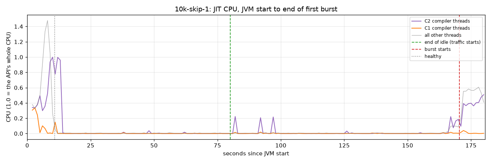 | 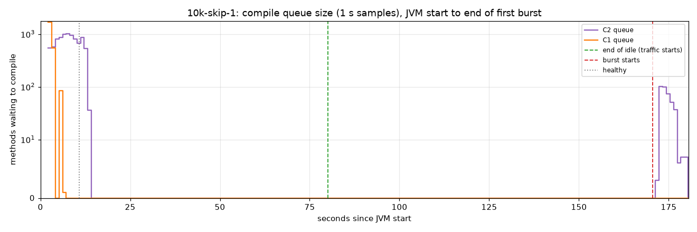 |
| skip-2 (4.0%) | 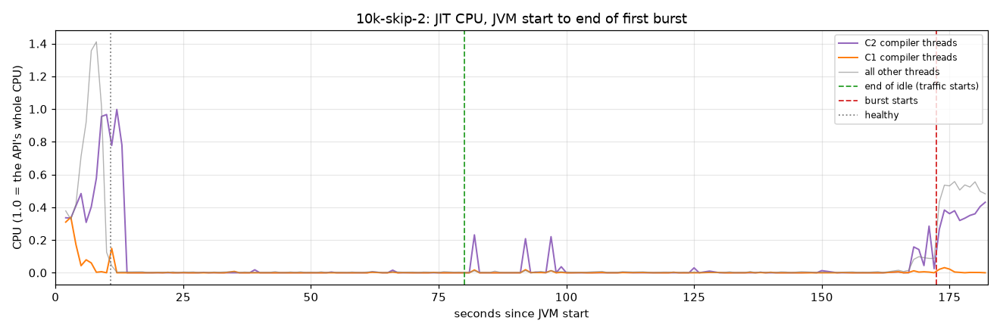 | 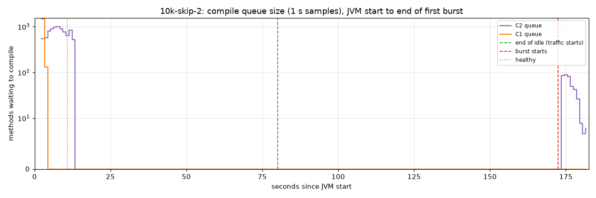 |
| warm-1 (99.99%) | 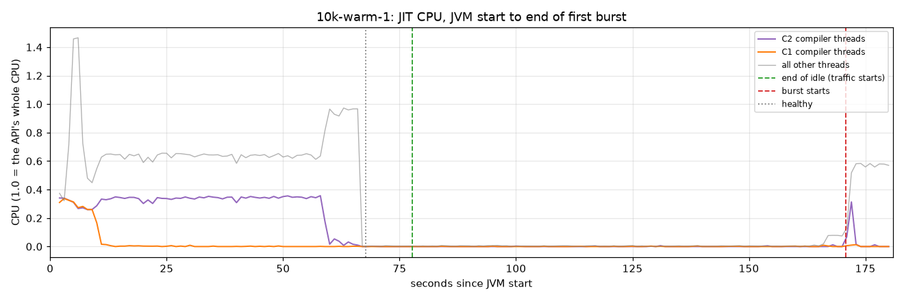 | 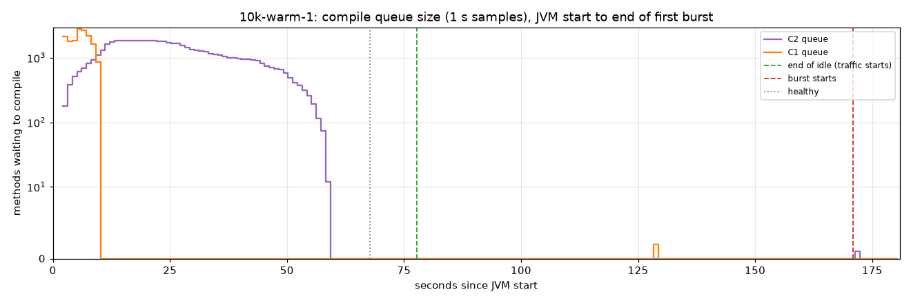 |
| warm-2 (99.94%) | 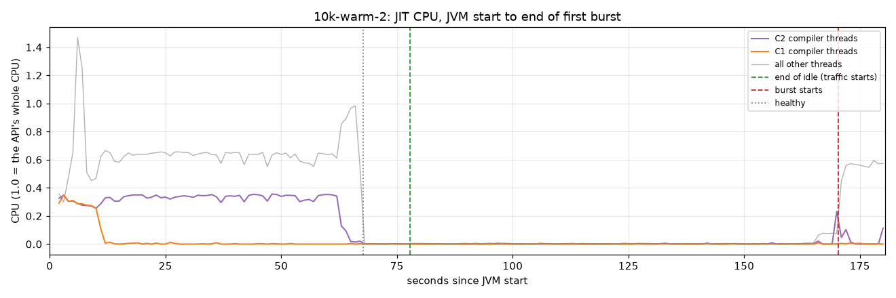 |  |

### 20k cache

| | JIT CPU | Compile queues |
|---|---|---|
| skip-1 (94.1%) | 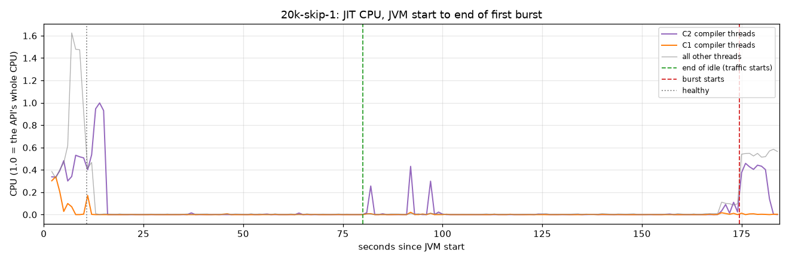 | 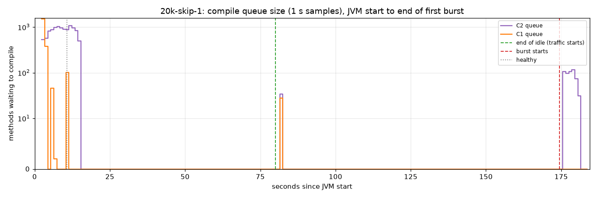 |
| skip-2 (79.4%) | 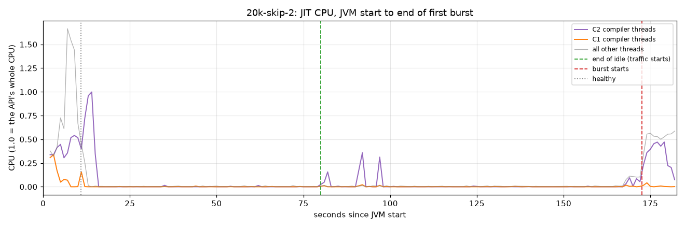 | 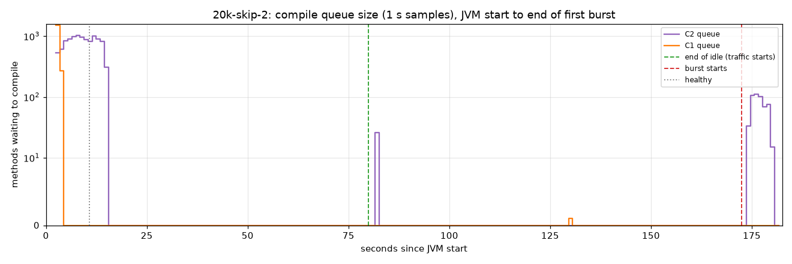 |
| warm-1 (99.90%) | 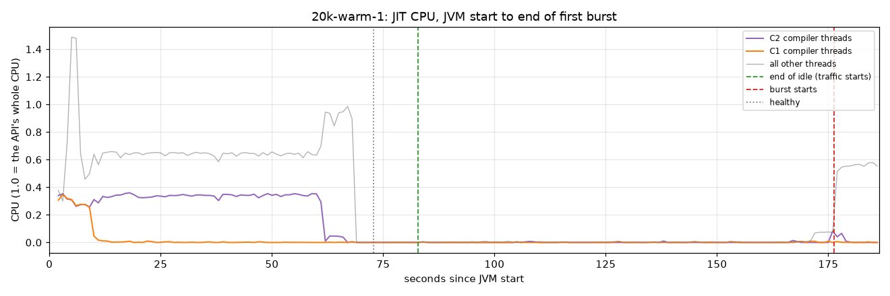 | 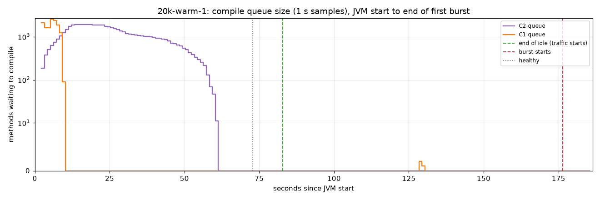 |
| warm-2 (98.27%) | 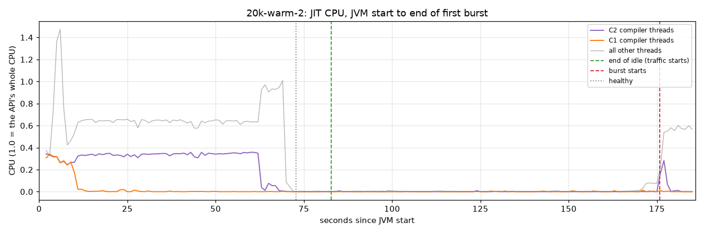 | 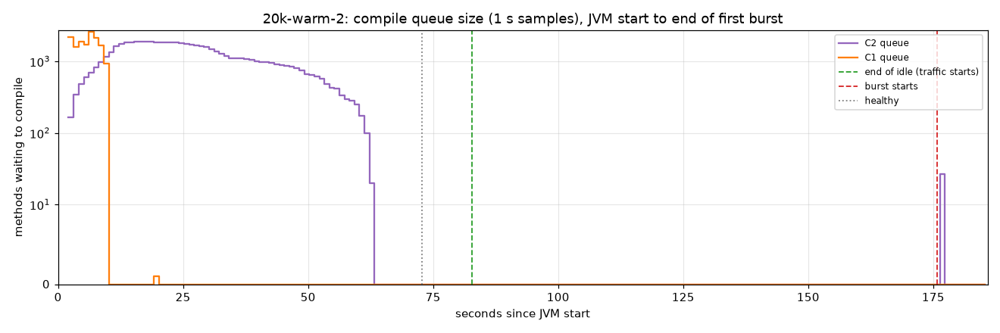 |

### 40k cache

| | JIT CPU | Compile queues |
|---|---|---|
| skip-1 (98.6%) | 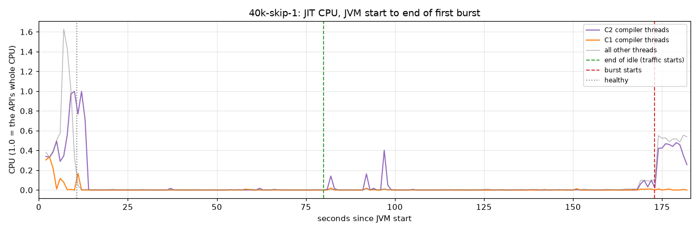 | 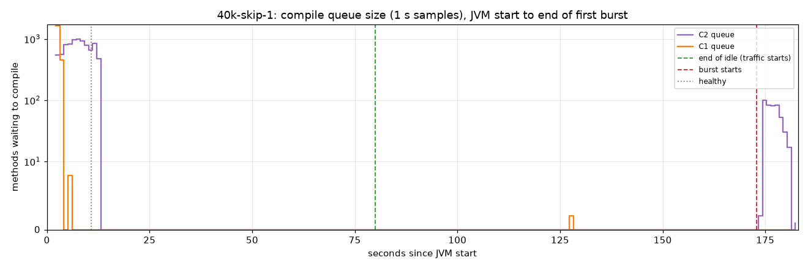 |
| skip-2 (3.7%) |  | 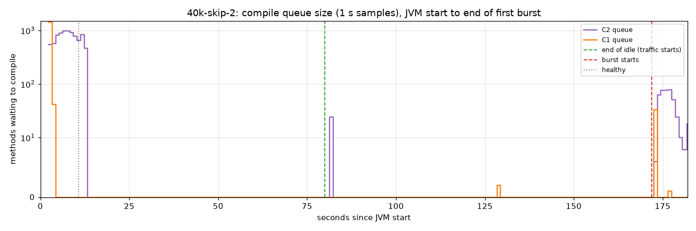 |
| warm-1 (99.98%) | 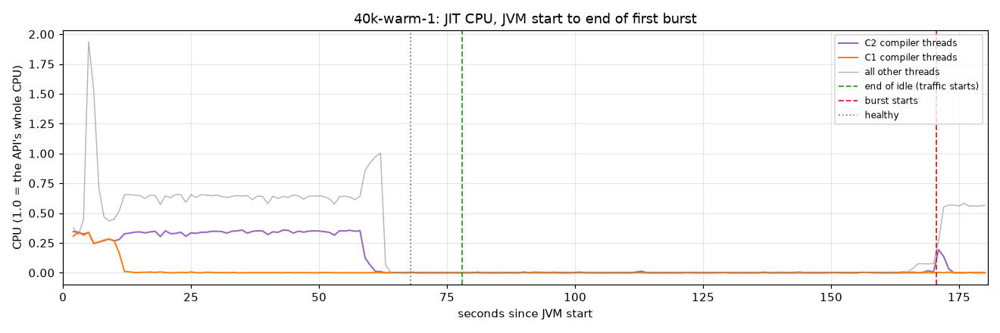 | 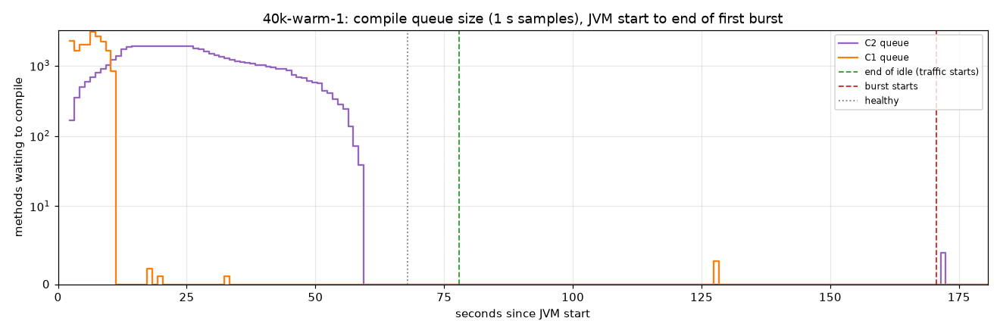 |
| warm-2 (99.95%) | 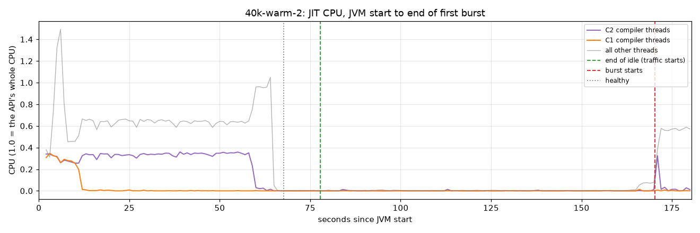 | 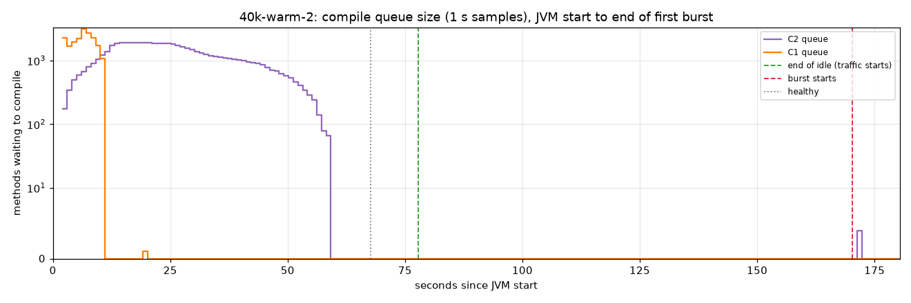 |

What the graphs show:
- **Skip:**
  - a C2 spike to about 1.0 CPU at 12–15 s (eager compilation from the AOT profiles);
  - small blips during the functional checks;
  - then C2 at 0.37–0.47 CPU for 7–8 s after the burst starts, with a C2 queue of about 100–115.
- **Warm:**
  - the warm-up (C2 at about 0.35 CPU until about 61 s);
  - almost no JIT activity in the burst (C2 queue 0–27, at most 1.1 s of C2 CPU).

## Why skip sometimes collapses

### Measured

1. **Skip has no CPU headroom in the burst.** For about 7–8 s, the single C2 thread compiles the request path
   at 0.37–0.47 CPU. About 160 request-path methods (Jackson, Tomcat, NIO, PgJDBC) were still running C1
   level-2 code, and they get C2 versions between +1 and +10 s. The container is at 0.93–1.01 CPU. The request
   path needs about 0.55 CPU at 2,000 req/s and gets about 0.55. Warm runs have about 45% of the CPU spare.
2. **The first GC lines up with the outcome.**

   | First GC relative to burst start | Runs | Outcome |
   |---|---|---|
   | +0.06 to +0.15 s | 10k skip-1, 10k skip-2, 40k skip-2 | collapsed (4%) |
   | +0.12 s | 20k skip-2 | collapsed, recovered after about 2 s (79%) |
   | −1.2 to −1.5 s, at 100 req/s | 20k skip-1, 40k skip-1 | passed or nearly (94%, 98.6%), one 65–90 ms stall costing about 5 requests |

   Warm runs had their first GC during warm-up, about 160 s earlier.
3. **Late requests turn into connection churn.** The checker drops its connection after every timeout. The
   Acceptor thread then uses 0.05–0.09 CPU in every collapsed second, against 0.00–0.01 in healthy seconds.
4. **The server's backlog grows.** The checker's GET lookups during the load:
   - 20k skip-2: 40–120 ms, then drained after about 2 s;
   - 40k skip-2: grew to 2.6–5.0 s;
   - 10k skip-1: grew to 1.6 s.

   The runs that never recovered also spent 0.3–1.0 CPU-s in non-Java threads, which on SerialGC is
   mostly GC.

### Inferred

Collapse is a metastable overload set off by a pause during the window with no headroom:
1. A first-GC pause of 70–90 ms, together with the onset spike, queues 200–300 requests, so new requests miss
   35 ms.
2. With C2 holding about 0.4 CPU, the backlog can't drain.
3. Abandoned requests are still processed. Timeouts cause reconnects and run cold connection-setup, close
   and error paths. A bigger backlog holds more live objects, so GC runs more often. Each of these feeds the
   overload.

Recompiles are similar in passing and collapsed runs, so they are not the cause.

**How the first GC was dated:** this recording had no GC events. The first GC was dated from the first
compile of the JMX GC-notification code (`GarbageCollectionNotificationInfo`, `GcInfo`), about 55 C1 compiles
in 40 ms. In the passing runs, the client saw a stop-the-world signature at the same instant: every request
was released at once after a 65–90 ms stall.

**Unexplained stall:** 20k skip-1 also had a 0.53 s stall of POST completions at +3.4 s, which cost 1,199
requests. Its cause isn't visible in this data.

Per-run details are in `graphs/{10k,20k,40k}-findings.md`: burst-onset tables at 250 ms resolution,
request-path C2 install times, and the longest compiles.

## Follow-up

The rerun ([`../20261119-jit-5s/REPORT.md`](../20261119-jit-5s/REPORT.md)) added JFR GC, safepoint and deopt
events, with 52 runs. It found:
- **The GC proxy held.** In all 26 skip runs, the GC-notification compile came 50–126 ms after a real GC
  started, at the end of its ~47 ms pause.
- **It's the JVM's first two GCs, not only the first.** In skip, the JVM never collects before the load test,
  so both of its first two GCs fall in or just before the burst. Each pauses for 37–82 ms, and each costs
  hundreds to 1,400 late requests. Later young GCs pause for only 2–14 ms. Warm runs take their first two
  GCs (25–73 ms) at about 5 and 10 s after JVM start, during warm-up.
- **The first GC's timing alone doesn't decide the outcome.** Of the five skip runs whose first GC came before
  the burst, only two passed.

## Files

- `tools/`:
  - `run_variant.sh` and `all.sh`: run the experiment;
  - `jit.jfc`: JFR settings;
  - `timeline.py`: the graphs and counts;
  - `analyze.py`: the summary;
  - `ReadRepo.java`: reads JFR repositories left by crashed JVMs.
- `<cache>/<variant>-<n>/`: raw data for each run.
- `graphs/`: PNGs, the per-run count JSONs, and the per-cache findings.
- `caches/`: the AOT caches used.
