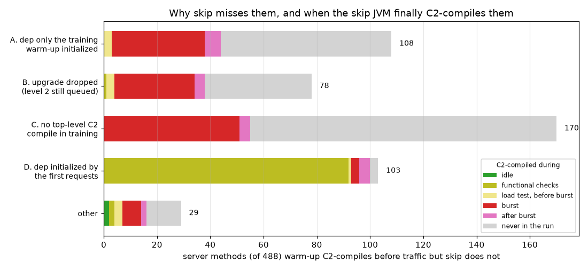

# Why SkipTier2IfPossible loses to warm-up: methods at C2 when traffic starts

Date: 2026-11-19. This report summarizes and extends the earlier ones: [jit-delay](../20261119-jit-delay/REPORT.md)
and [jit-5s](../20261119-jit-5s/REPORT.md). It adds a source-level investigation of HotSpot's training replay
and a follow-up experiment (fix A plus an idle-period GC).

## Summary

- **Warm-up starts traffic with about 900 more methods at C2 than skip does: 2,339 vs 1,436 per run.**
  - About 300 of the difference is warm-up's own HTTP client and generated code. Serving doesn't need them.
  - **488 are server methods on the request path,** such as Tomcat, NIO, Jackson, PgJDBC, Hikari and our
    servlet. Skip has to compile those with C2 after traffic arrives, about 300–370 C2 compiles in all. That
    keeps C2 at about 0.4 of the API's single CPU for the first 8 s of the burst.
  - This is the root of skip's failures: it passed 3 of 26 runs, against 23 of 26 for warm-up.
- **The AOT cache knows about all of these methods.** All but one have training data, with stored profiles.
  Eager compilation still doesn't C2-compile them before traffic, for three reasons visible in the HotSpot
  source (JDK 25):
  - **A. Dependencies only the training run initialized (108 methods).** A replayed C2 compile waits until every
    class the training compile looked at is initialized. Some of those classes belonged to the warm-up's own
    HTTP client and are never initialized in a JVM without warm-up. This one we could fix in our setup, and it's
    now done.
  - **B. A dropped upgrade (78 methods).** Each method's last dependency was met while its eager level-2 compile
    was still queued, so the C2 upgrade was skipped and never retried.
  - **C. No top-level C2 compile in training (170 methods).** Training compiled them on their own only at C1. 134
    reached C2 only inlined into callers. Eager compilation never takes these past level 2.
  - **D. Dependencies initialized by the first real requests (103 methods).** These work as designed, but only
    once traffic has started.
- **The general hurdle is D.** Request-path code depends on classes that are initialized by the first request.
  JDK 25's eager compilation therefore can't put a service's request path at C2 before the first request, however
  much it was trained. For a service with many endpoints, the C2 backlog at first traffic grows with the number
  of endpoints; the projection puts it at 600–1,900 methods for 10 endpoints.
- **The end goal is having the request path's code ready before the first request, at little CPU cost.**
  JDK 25 can't do this without synthetic traffic. Warm-up does it, at about 60 s of startup CPU. JDK 28's AOT
  code compilation (JEP 544, in mainline) is designed for it: "preload" C2 code with class-initialization
  barriers that runs before dependencies are met.

## 1. Background: why more C2 at startup, and the ideal

HotSpot starts every method in the interpreter, then compiles it with C1, which is quick but only moderately
fast code, and then with C2 once it's hot enough and profiled. C2 code is typically several times faster than
C1 code, but each C2 compile costs milliseconds to about a second of CPU. In this service, about 300 burst C2
compiles cost about 3.1 CPU-seconds.

That compile work has to happen somewhere. If it happens after traffic starts, it competes with requests for
CPU exactly when the service is least warm.
- **Measured here:** a container with 1 CPU and an SLA of more than 95% of requests acknowledged within 35 ms
  at 2,000 req/s.
- **Skip:** C2 used 0.37–0.41 CPU for 8 s, leaving almost no headroom. Any pause, such as a 40–80 ms GC or a
  45 ms hiccup in the checker, then turned into hundreds or thousands of late requests, and sometimes a
  collapse into overload that never recovered.
- **Warm-up:** it had done that work before reporting healthy. Its C2 used 0.04–0.05 CPU in the burst, the same
  stalls cost a few dozen requests, and it passed 23 of 26 runs.

**The ideal end state** is that, before the instance reports healthy:
1. Every method that will be hot in steady state is already at C2, so no JIT work competes with requests. In
   this service that's about 2,000 methods; warm-up gets close, with about 45 C2 compiles left for traffic.
2. The profiles behind that code match production, so there's no wave of deoptimizations and recompiles at
   first traffic.
3. The heap has its long-lived startup objects already promoted, so the first young GCs under load are cheap.
   This was the second skip problem, fixed separately (section 4).
4. Ideally, none of this costs much CPU at startup either: compiled code is loaded rather than compiled, and
   no synthetic traffic is needed. Warm-up meets 1–3, but costs about 60 s of startup CPU and needs
   side-effect-free self-traffic, which here means a separate warm-up table.

SkipTier2IfPossible with an idle period was meant to get to 1 using the AOT cache's training data instead of
traffic. The rest of this report explains why it doesn't.

## 2. Measured gap

Runs: 26 per variant (jit-5s). Skip is `-XX:+SkipTier2IfPossible` and `-XX:+AOTCompileEagerly` with an AOT
cache, then 80 s idle. Warm is the in-process startup warm-up, 60–65 s.

Counting methods C2-compiled before traffic in at least 80% of a variant's runs:

| | Methods |
|---|---|
| C2 in both variants | 977 |
| C2 in warm, and in 20–80% of skip runs (varies run to run) | 313 |
| C2 in warm only: server code | **488** |
| C2 in warm only: warm-up's own `java.net.http` client and its `CompletableFuture` chains | 261 |
| C2 in warm only: generated code (lambda forms) | 37 |
| C2 in skip only | 101 |

The 488 server methods are the gap that matters: JDK and Jakarta 242, Tomcat 85, Jackson 54, PgJDBC 46,
Spring 18, the application 17, Hikari 16 and others 10. During traffic, skip did about 300–370 C2 compiles,
against about 45 for warm. About 230 of those were level-2 → C2 upgrades of methods eager compilation had left
at C1.

## 3. Why eager compilation leaves them at C1 (JDK 25 source)

The relevant code is in `src/hotspot/share/compiler/compilationPolicy.cpp` and `oops/trainingData.cpp`, at tag
`jdk-25-ga`. The runtime is Temurin 25.0.5.

**The rule.** `trained_transition_from_none` sends a method straight to level 4 only if all three hold:
1. its training data has a top-level C2 compile;
2. a profile was stored;
3. `SkipTier2IfPossible && ctd->init_deps_left() == 0`.

Otherwise it gets level 2. A method waiting at level 2 is upgraded when its dependency count reaches 0, via
`replay_training_at_init` → `maybe_compile_early` → `trained_transition_from_limited_profile`.

**What counts as a dependency.** In `CompileTrainingData::notice_jit_observation`, every class that a training
C2 compile looked at, and that was initialized at the time, becomes an init dependency. The code comment
describes this as "conservatively" assuming the JIT depends on its initialization. For example,
`HikariDataSource::getConnection` has 52 dependencies, including Micrometer timer classes.

**How we measured it:**
- **The cache's training data:** `-XX:+AOTPrintTrainingInfo` dumps every compile record and its dependencies.
- **When each class was counted down:** `-Xlog:training=debug`.
- **Every eager decision and the method's dependency counter:** `-XX:+PrintTieredEvents`.
- **Which methods got compiled when:** JFR.

The data is from one instrumented skip run and one idle-only run, both on the 40k cache.

| Cause | Methods | C2 during the burst | Never C2 in the run |
|---|---|---|---|
| A. A dependency class initialized only by the training run's warm-up client (`MinimalFuture`, `CompletableFuture$Uni*`, `Http1Exchange`, `HeapByteBufferR`, …) | 108 | 35 | 64 |
| B. Last dependency met while the eager level-2 compile was still queued; `maybe_compile_early` then skips the C2 upgrade (`!compilation_is_in_queue(m)`) and nothing re-checks until traffic | 78 | 30 | 40 |
| C. No top-level C2 compile in training (C1 only; 134 were C2 only as inlinees), so the trained path stops at level 2 and C2 follows only from this run's counters | 170 | 51 | 115 |
| D. Dependency classes initialized only by the first real requests (Jackson parser, `PgPreparedStatement`, …); became eligible during the functional checks | 103 | 3 | 3 |
| Other: no training data (1), or dependencies met with no C2 and no clear cause | 29 | 7 | 13 |

In D, 92 of the 103 methods reached C2 during the functional checks.

Evidence for each cause:
- **B in the idle-only run:**
  - **Last dependency met while the level-2 compile was queued:** 104 of 124 methods never got C2 during idle.
  - **Met after level 2 was installed:** 142 of 185 did.
  - **Example:** `getConnection` was queued at level 2 at 10.2799 s with `deps=9`. Its remaining dependencies
    were counted down at 10.280 s while 894 compiles waited in the C2 queue.
- **B in current JDK `master`:** still present; the queue check is unchanged.
- **D is not a bug.** The design doesn't let code that assumes a class is initialized run before that class has
  been initialized. Request-path classes are initialized by requests, so during an idle period with no traffic
  that code can't be installed.

## 4. Follow-up: fixing A, plus a GC during the idle period

Two changes, then 4 runs of each variant on a 40k cache retrained with them (experiment depfix-gc):
- **Fix A:** record the AOT cache with the in-process warm-up off. Compile records depending on HttpClient classes
  went from 20,740 of 109,210 to 0 of 78,669.
- **Idle-period GC:** one `System.gc()` 60 s after startup. Skip's first two young collections had cost 37–82 ms
  each in the burst, because they copied the objects left live by startup.

| | Skip before (10 runs) | Skip after (4 runs) |
|---|---|---|
| C2 compiles during traffic | 369 | 304 |
| C2 level raises during traffic | 244 | 192 |
| C2 CPU, first 8 s of the burst | 0.41 | 0.39 |
| First GC pause in the burst | 46–56 ms | 5–11 ms (52 ms in the collapsed run) |
| On time | 2 of 10 passed | 1 of 4 passed (86.3%, 95.8%, 9.6%, 93.9%) |

The GC problem is gone and the compile backlog shrank by about 18%, but C2 still takes about 0.4 CPU for 8 s:
- **B, C and D are untouched.**
- **Losses now come from other small stalls.** Most came from a 30–48 ms stall in the load generator's own
  sender at the same point in every run, including warm runs. Warm absorbs it in about 0.2 s; skip needs about
  0.6 s.
- **One skip run collapsed with no trigger at all.**
- **One warm run (60%) failed for an unrelated reason:** Postgres was saturated.

## 5. Projection: services with more than one endpoint

This service has two endpoints that share almost all of their request path: POST and GET `/events`. Real
services usually have many. The hurdles above scale with that, roughly as follows.

**Model.** The request-path methods that need C2 are F + K × E:
- **F** is shared request infrastructure: HTTP server, NIO, JSON core, JDBC driver, pool and JDK concurrency;
- **K** is the number of endpoints with distinct code;
- **E** is each endpoint's own code: its controller and service, its DTOs' (de)serializers, its queries.

Calibration: K = 2 must reproduce this service's 488 methods and 3.1 C2 CPU-seconds, which gives F ≈ 400 and
E ≈ 45. The application package alone contributed 17 methods, and endpoint-specific Jackson and PgJDBC paths
make up the rest. I use E = 20–150 for leaner to heavier endpoints. Compile CPU is scaled from the measured 3.1
CPU-seconds.

These are assumptions for illustration, not measurements of another service.

| Endpoints (K) | Request-path methods needing C2 (E = 20 / 45 / 150) | C2 CPU-seconds, same three cases |
|---|---|---|
| 1 | 420 / 445 / 550 | 2.7 / 2.8 / 3.5 |
| 2 (this service) | 440 / 490 / 700 | 2.8 / 3.1 / 4.4 |
| 10 | 600 / 850 / 1,900 | 3.8 / 5.4 / 12 |
| 50 | 1,400 / 2,650 / 7,900 | 9 / 17 / 50 |

How many of those methods each approach gets to C2 before the endpoint's first request:
- **SkipTier2IfPossible on JDK 25, even with fix A: about none.**
  - The 21% in D, plus whatever share of A's methods depend only on request-initialized classes, become eligible
    at the endpoint's first request and are compiled in a wave right then.
  - The roughly 57% in B, C and "other" wait for this JVM's invocation counters, i.e. for load.
  - So every endpoint's first traffic carries its own compile backlog, and a cold endpoint reached for the first
    time hours later pays it then.
  - The "about none" doesn't depend on K, but the backlog grows linearly with K, and so does the window in
    which the instance has no CPU headroom.
- **Warm-up that exercises every endpoint: about all of them,** but the same compile CPU moves into startup.
  This service already spends about 60 s of warm-up. That grows with K, and warm-up traffic has to stay
  representative of, and isolated from, real data for every endpoint.
- **AOT code with preload (JEP 544, JDK 28 mainline): most of them, at little CPU.** This is a rough guess, not
  measured.
  - Code is compiled at AOT-cache creation and loaded, not compiled, in production.
  - "AP4" preload code carries class-initialization barriers, so it can run before dependencies are met. That
    removes the dependency gate behind A and D, and since nothing has to wait for a level-2 compile, B also goes
    away.
  - C becomes a smaller problem when its methods are inlined into callers that have AOT code.
  - I'd expect 65–90% of the request path to have C2-quality code before the first request.
  - The remaining 10–35% is my estimate of methods with no top-level C2 compile in training and not covered
    through inlining. It's an extrapolation from C's 35% share here.

## 6. Conclusions

- On JDK 25, AOT training data plus SkipTier2IfPossible and eager compilation C2-compile startup and shared code
  well. They can't C2-compile the request path before traffic, because those compiles depend on classes that
  only requests initialize. Training size doesn't matter: 10k, 20k and 40k training calls gave the same counts.
- Of skip's problems, the ones we could fix are fixed:
  - training no longer records dependencies on the warm-up client (A);
  - an idle-period GC keeps the expensive startup GCs out of the burst.
  B is a HotSpot policy race that could be reported upstream. C and D are inherent to JIT-only replay.
- For this service on JDK 25, startup warm-up remains the reliable way to meet the SLA. For services with many
  endpoints, warm-up's cost grows with the number of endpoints and skip's backlog grows with it too. The way out
  is AOT code that can run before class initialization, which is what JEP 544's preload code targets.

## Data

Experiments, in the work-trial repository's `evaluations/`, which is not published:
- jit-5s: 52 runs;
- training-deps: the instrumented run, the idle-only `PrintTieredEvents` run and the training-data dump;
- depfix-gc: fix A plus the idle-period GC, 8 runs.

The figures are generated by `evaluations/20261119-skip-vs-warm-report/figures.py` there.
